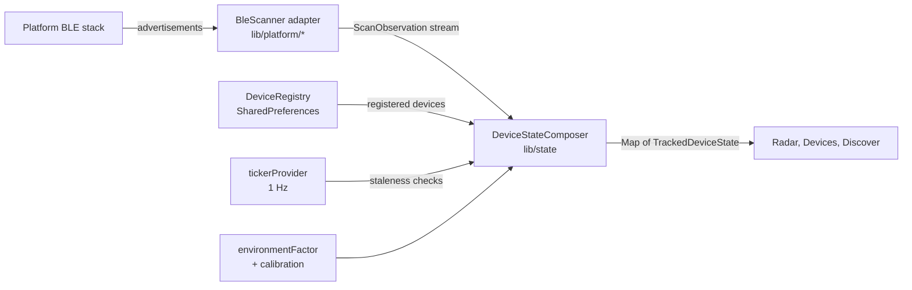

# Architecture

This explains how the app is put together. Read [the README](../README.md) first for what it does and how to run it, and [the spec](../ble-tracker-spec.md) for what it must do. The spec's FR/NFR numbers appear in code comments and tests.

## Layers

The code is split into four layers. Dependencies point downward only.

```
lib/ui/        screens and the radar painter. Reads providers, calls actions.
lib/state/     Riverpod providers and the device-state composer.
lib/domain/    pure logic: no Flutter, no plugins, no real timers, no I/O.
lib/platform/  adapters for BLE stacks, storage and Android/Wear channels.
```

Every boundary between layers is a Dart `abstract interface class` in `lib/domain/interfaces.dart`. Platform code implements those interfaces; the rest of the app only sees the interfaces.

## Data flow



1. A **scanner adapter** turns platform advertisements into `ScanObservation`s (device ID, RSSI, optional TxPower, timestamp).
2. The **composer** keeps per-device state: it smooths RSSI with the Kalman filter, converts it to a distance, and decides visibility. It is the single source of truth for what the UI shows.
3. The **UI** renders the composer's output. It never talks to the platform directly.

## Where the rules live

| Concern | Rule | Where it's enforced |
|---|---|---|
| Time | Logic takes time from observation timestamps and the injected ticker, never `DateTime.now()`. The radar fade is the one exception. | Code review; tests drive time with stream controllers |
| Tunables | Numbers such as noise, band thresholds and staleness live in `ProximityConfig`. | `lib/domain/config.dart` |
| Visibility | A device becomes visible only when observed. Registry updates never revive stale devices. | `DeviceStateComposer` and its tests |
| Scanner lifecycle | Scanners follow the state machine in spec §5.4. Illegal transitions throw. | `ScannerStateMachine` |
| Adapter parity | Every scanner passes the same contract suite, so the fake and the real adapters behave the same. | `test/contract/ble_scanner_contract.dart` |
| Plugin isolation | Each plugin is wrapped in a thin `*Api` interface. The `*ApiImpl` classes are not unit-tested; the manual checklist covers them. | `lib/platform/*/..._api.dart` |
| Coverage | Code in `lib/domain/` and `lib/state/` must be 100% line-covered. | `tool/coverage_gate.dart`, run in CI |

## Providers

Riverpod providers in `lib/state/providers.dart` wire everything together. The ones you'll meet most:

| Provider | What it gives | Overridden in `main.dart` |
|---|---|---|
| `bleScannerProvider` | The active scanner | yes (platform factory) |
| `deviceRegistryProvider` | Registered devices | yes (persistent registry) |
| `tickerProvider` | 1 Hz ticks for staleness | yes |
| `platformCapabilitiesProvider` | Tier and what the platform supports | yes |
| `settingsStoreProvider`, `initialEnvironmentFactorProvider` | Settings storage and the stored `n` | yes |
| `backgroundScanHostProvider` | Android background service, or a no-op | yes |
| `deviceStatesProvider` | `Map<id, TrackedDeviceState>` from the composer | no (derived) |
| `scannerStatusProvider` | idle / scanning / unavailable / unauthorized | no (derived) |
| `latestRssiProvider`, `discoveryObservationsProvider` | Raw observations, for detail sheet and Discover | no (derived) |
| `environmentFactorProvider`, `resumeNoticeProvider` | Settings value; Tier B "paused" notice | no (notifiers) |

Platform-bound providers throw `UnimplementedError` unless overridden, so a missing override fails loudly instead of silently running the wrong scanner.

## Optional capabilities

Some features exist only on some platforms. They are separate interfaces, checked with `is` at the point of use, so the base `BleScanner` stays small:

| Interface | Implemented by | Used for |
|---|---|---|
| `ManualPairing` | `WebBluetoothScanner` | Tier C "Pair a device" button |
| `RemoteIdFilterable` | `FlutterBluePlusScanner` | Android background scans limited to registered devices (#32) |
| `BackgroundScanHost` | `AndroidBackgroundScanHost` (no-op elsewhere) | Starting and stopping the Android foreground service (#28) |

## Platform adapters

| Folder | Platforms | Stack |
|---|---|---|
| `lib/platform/fbp/` | Android, iOS, macOS, Windows | `flutter_blue_plus` |
| `lib/platform/bluez/` | Linux | BlueZ over D-Bus (`bluez` package) |
| `lib/platform/web/` | Web (Chrome) | Web Bluetooth (`flutter_web_bluetooth`) |
| `lib/platform/wear/` | Wear OS | Wraps another adapter; drops to balanced scanning while ambient |
| `lib/platform/android/` | Android | Background service channel |
| `lib/platform/shared_prefs_store.dart` | all | Key-value storage for the registry and settings |

`lib/platform/scanner_factory_io.dart` picks the adapter for native builds, and `scanner_factory_web.dart` for the web build. `main.dart` chooses between them with a conditional import.

## Native code

Kotlin in `android/app/src/main/kotlin/com/matella/ble_tracker/`:

- **`MainActivity`** hosts Flutter and owns two channels:
  - `ble_tracker/ambient` (EventChannel): Wear OS ambient enter/exit. Registered only on watch hardware.
  - `ble_tracker/background` (MethodChannel): `start` and `stop` for the background service.
- **`BackgroundScanService`** is a connected-device foreground service. It keeps the process alive and posts a notification. It does not scan itself. It stops on task removal.

The phone and Wear builds come from the same Android module. A `--dart-define=WEAR_OS=true` build selects the watch behaviour, and the watch-only manifest entries are harmless on phones.

## Adding a new platform adapter

1. Implement `BleScanner` in a new folder under `lib/platform/`. Keep plugin calls in a thin `*Api` interface and a matching `*ApiImpl`.
2. Use the scanner state machine (`ScannerStateMachine`) for every status change. Serialise state-changing operations the way `FlutterBluePlusScanner` does with `_enqueue`, and never call another queued method from inside one.
3. Add the adapter to the contract suite: `runBleScannerContract(...)` in a test under `test/platform/`, with a `ScannerHarness` that drives the fake backend.
4. Wire it in the factory and the tier logic in `DefaultPlatformCapabilities`.
5. Add a row to the manual checklist for the new platform.

## Testing by layer

| Layer | How it is tested |
|---|---|
| `domain/` | Unit tests, no Flutter. Time is driven by values passed in. |
| `state/` | Provider and composer tests with stream controllers. |
| `platform/` | Adapter tests against fake `*Api` objects, plus the shared contract suite. The `*ApiImpl` classes are not unit-tested. |
| `ui/` | Widget tests with overridden providers. The radar has screenshot (golden) tests. |
| Hardware | `docs/manual-test-checklist.md`, run by hand per release. |

Use bounded `pump(duration)` calls in tests that involve the radar's repeating animation: `pumpAndSettle` never settles there.

## Decisions on record

- **Environment factor `n` is global**, not per device. Calibration instead stores each device's reference RSSI at 1 m (spec OQ-3, resolved in #27).
- **Kalman process noise is not scaled by elapsed time.** The default was tuned per observation; changing it would silently alter every estimate (#22).
- **Android background scanning uses a foreground service and a MAC-address filter while backgrounded.** Rotating private addresses are not covered by that filter (#28, #32).
- **Built-in Kotlin is not yet enabled.** The Kotlin version bundled with AGP 9.4.1 is below Flutter's minimum (#34).

The v1 build plan in `docs/superpowers/plans/` records the original reasoning behind the layering and the task breakdown.
